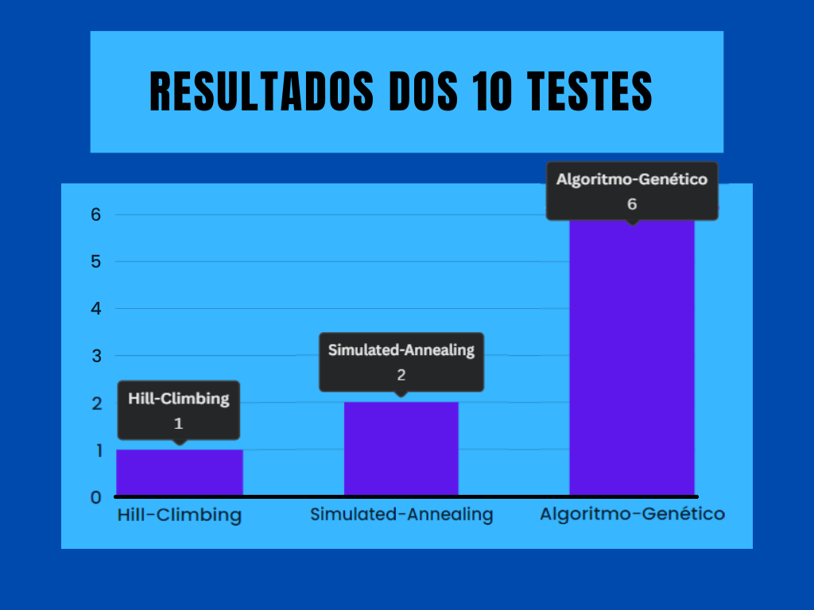
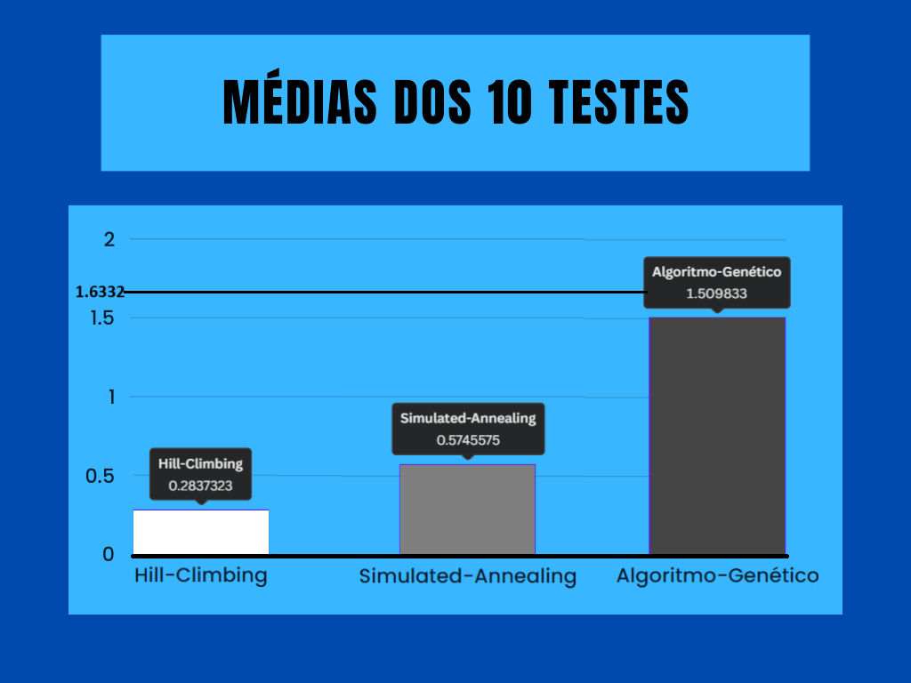
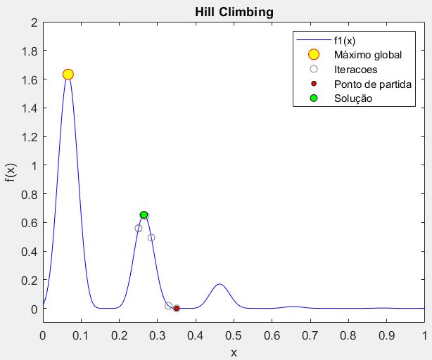
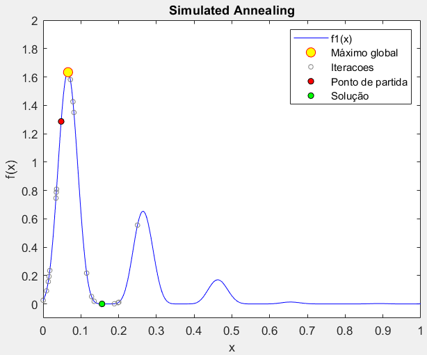
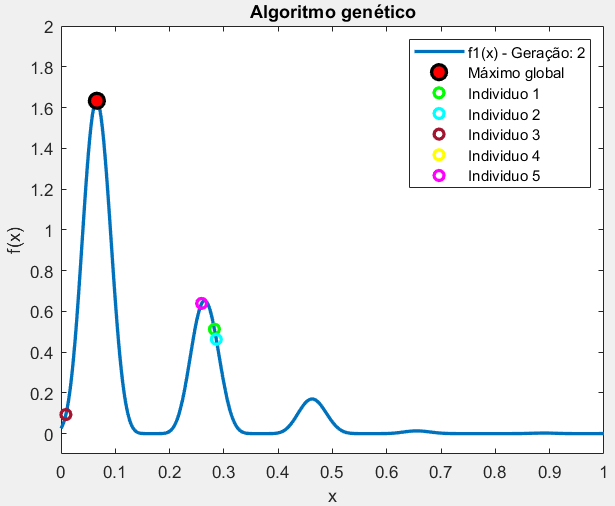
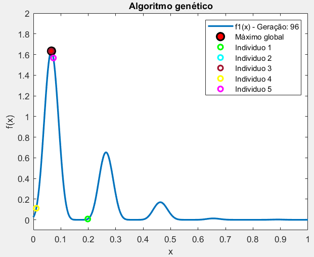
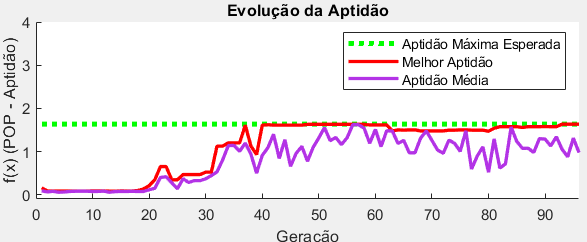

# Search Methods for Optimization

Three classic AI search algorithms, Hill Climbing, Simulated Annealing, and a Genetic Algorithm, implemented from scratch in MATLAB and benchmarked against each other on the same optimization problem. Built for the Artificial Intelligence course of my BSc in Computer Engineering at UTAD.

## 🎯 The problem

Find the global maximum of:

```
f(x) = 4 · sin(5πx + 0.5)⁶ · exp(log2((x - 0.8)²)),  x ∈ [0, 1]
```

This function is deliberately nasty for local search: it has a tall global peak around x ≈ 0.066 (f ≈ 1.633), but also several smaller local peaks nearby, exactly the kind of landscape that traps a naive hill climber.

## ⚙️ The three methods

- **Hill Climbing** (`src/Hill_Climbing.m`), always moves to a neighboring point if it's better, never accepts a worse one. Fast, but has no way to escape a local maximum once it finds one.
- **Simulated Annealing** (`src/Simulated_Annealing.m`), same idea, but will sometimes accept a worse neighbor, with a probability that depends on how much worse it is and on a "temperature" that cools down over time. Early on it explores more; later it behaves more like hill climbing.
- **Genetic Algorithm** (`src/Genetic_algorithm.m`), evolves a population of 5 candidates over 96 generations. Each candidate is a binary string that gets decoded back into a real number to be evaluated, then the whole population goes through roulette-wheel selection, single-point crossover and bit-flip mutation to produce the next generation. Encoding, decoding, selection, crossover and mutation are all hand-written from scratch rather than a toolbox call, which also made this by far the most involved of the three to design and debug.

## 📊 Results, 10 runs each

<p align="center">
  
  
</p>

| Method | Found the true global max | Average f(x) achieved |
|---|---|---|
| Hill Climbing | 1 / 10 | 0.284 |
| Simulated Annealing | 2 / 10 | 0.575 |
| **Genetic Algorithm** | **6 / 10** | **1.510** |

(True global maximum: f(x) = 1.6332)

Hill Climbing's weakness shows up directly: most runs converge to a nearby local peak instead of the real maximum.

<p align="center">
  
</p>

Simulated Annealing's temperature-driven exploration helps, but with this schedule it still gets stuck on some runs:

<p align="center">
  
</p>

The Genetic Algorithm's population-based search, several candidates exploring in parallel, recombining and occasionally mutating, is what actually gets past the local peaks most of the time. Plotting the population early and late in the same run shows why: by generation 2 most individuals are already parked on a local peak, by generation 96 selection pressure has pulled most of them onto the true global maximum instead.

<p align="center">
  
  
</p>

Tracking fitness across all 96 generations makes the mechanism visible. The best individual improves in sudden steps, each one a crossover or mutation that happened to land closer to the peak, while the population average keeps oscillating underneath it since selection does not erase a worse gene immediately, it only makes it less likely to be picked again.

<p align="center">
  
</p>

## 🛠️ Tech Stack

<p align="center">
  
</p>
<p align="center">
  
  
  
  
</p>

## 👤 About

Part of my portfolio. See my [GitHub profile](https://github.com/linho22w) for more projects in AI/ML and backend development.
